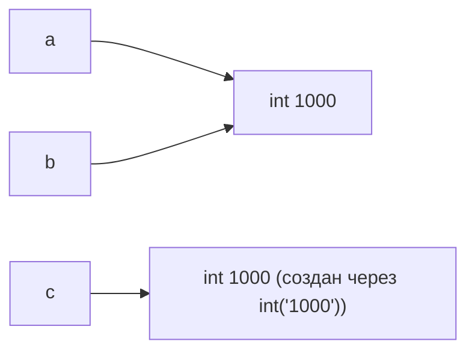

# Цель работы

Разобраться, как CPython выполняет программу, научиться отличать имя от объекта, корректно применять операции сравнения и работать с базовыми типами данных Python.

# Ход работы

## Задание 1. От исходного кода к байткоду

### Часть 1. Режимы запуска

REPL (Read – Eval – Print - Loop) на своём третьем шаге автоматически выводит результат каждого выражения. Интерпретатор считывает введенную строку, вычисляет её и, если она была выражением, печатает полученное значение, после чего ожидает следующего ввода.

С файлом иначе. Когда я запускаю task_1.py, Python читает инструкции, выполняет их по очереди и выводит только то, что было явно указано вывести. Выражение 2 + 3 * 4 было вычислено, но его результат никуда не сохранился и не отобразился.

### Часть 2. Выражения и инструкции

В файл были добавлены 3 новых строки. Разберём содержимое файла.

**Какие фрагменты являются выражениями:**

1. 2 + 3 * 4
2. "Python"
3. 4 * 2
4. f"{course}: {hours} часов"
5. print(f"{course}: {hours} часов") — как вызов функции (возвращает None)

**Какие строки являются инструкциями:**

1. print(2 + 3 * 4)
2. course = "Python"
3. hours = 4 * 2
4. print(f"{course}: {hours} часов") — инструкция-выражение

**Какие литералы присутствуют в программе:**

1. 2, 3, 4 — целочисленные литералы
2. "Python" — строковый литерал
3. f"{course}: {hours} часов" — особый литерал форматированной строки

**Какие имена создаются при выполнении программы:**

1. course
2. hours

### Часть 3. AST и байткод

Версия интерпретатора: Python 3.14.4

Выполним команду `python -m ast task_1.py`.

В AST можно выделить следующие узлы:

1. Assign – присваивание (course = "Python", hours = 4 * 2)
2. BinOp – бинарная арифметическая операция (2 + 3 * 4 и 4 * 2)
3. Call – вызов функции print()

Выполним команду `python -m dis task_1.py`.

В дизассемблированном коде можно выделить:

1. LOAD_CONST – загрузка константы (например, "Python")
2. CALL 1 – вызов функции с одним аргументом

Названия инструкций байткода зависят от версии CPython. Это связано с тем, что байткод — внутренняя деталь реализации интерпретатора и может меняться между версиями.

Байткод CPython нельзя считать машинным кодом процессора, потому что он является промежуточным представлением программы, понятным виртуальной машине CPython, а не процессору. В отличие от машинного кода он выполняется виртуальной машиной, а не железом, не привязан к архитектуре процессора (работает на x86, ARM и других), но при этом зависит от версии CPython. Кроме того, байткод не исполняется процессором напрямую — между ним и процессором стоит интерпретатор CPython, написанный на C.

## Задание 2. Имена, объекты и сравнение

Был создан файл task_2.py со следующим содержимым.

Последний прогноз был ошибочным, так как я предположила, что небольшие числа кэшируются и переиспользуются. Оказалось, что это верно для чисел от -5 до 256, а 1000 не входит в диапазон. Поэтому `int("1000")` создаёт новый объект, а выражение `a is c` возвращает False.

Представим связи между именами и объектами:

Равенство значений проверяет, совпадают ли значения объектов. Идентичность же проверяет, указывают ли ссылки на один и тот же объект.

Изменим значение переменной c на None и добавим соответствующую проверку.

Отдельно был выполнен следующий код:

CPython интернирует некоторые строки, которые являются идентификаторами или короткими строками из ASCII-букв, цифр и знаков нижнего подчеркивания. В случае интернирования один и тот же объект может использоваться много раз. Так как ссылки указывают на один и тот же объект, то выражение `first is second` возвращает True. При этом `first == second` тоже возвращает True, но уже потому, что значения строк одинаковые.

Таким образом, оператор `is` стоит применять только в тех случаях, когда нам явно нужно проверить, указывают ли ссылки на один и тот же объект, а также в случае сравнения с None. Во всех других случаях, в том числе при сравнении значений, стоит использовать `==`.

**Ответы на контрольные вопросы:**

1. `b = a` не создаёт копии объекта. Инструкция копирует ссылку, тем самым `a` и `b` указывают на один и тот же объект.
2. Функция `type()` возвращает тип объекта, его класс (`<class 'int'>`, `<class 'str'>` и т.д.), а `id()` – уникальный идентификатор объекта, его адрес в памяти.
3. None принято сравнивать с помощью `is`, так как в программе существует всего один объект None, все ссылки указывают именно на него. В свою очередь в числах и строках нам важно значение, а не идентичность какому-то объекту, поэтому используется `==`.

## Задание 3. Числовые типы, операции и преобразования

### Эксперимент A.

Создадим файл task_3.py и выведем результаты семи арифметических операций.

Оператор `//` возвращает результат целочисленного деления с округлением вниз до ближайшего целого, а `/` возвращает фактический результат деления. В связи с этим результат может быть разных типов данных: при целочисленном делении он зависит от операндов, а при операторе `/` это всегда число с плавающей точкой.

### Эксперимент B.

Вычислим результат выражения.

В отличие от целых чисел во многих языках программирования, где тип имеет фиксированный размер (32 бита тип `int` и 64 бита тип `long` в C++), Python использует произвольную точность. Это позволяет увеличивать объем памяти, выделяемый под число, по мере необходимости и избегать переполнения (overflow). Из-за такой реализации большие числа обрабатываются медленнее, но с корректной точностью.

### Эксперимент C.

Добавим следующий код.

В результате сложения чисел 0.1 и 0.2 получается не ровно 0.3, а число с погрешностью. Это связано с форматом хранения чисел с плавающей точкой (стандарт IEEE 754). Числа хранятся в двоичном виде, как знак × мантисса × 2экспонента. Так как не все дроби можно выразить через степени двойки, возникает погрешность, которая влияет на арифметические действия.

Таким образом, сравнивать числа с плавающей точкой на равенство с помощью `==` нельзя. Для этого следует использовать функцию `isclose()` из модуля `math` или же самостоятельно задавать погрешность.

### Эксперимент D

Функция `bool("False")` возвращает истинное значение, так как её аргументом является непустая строка. В Python любая непустая строка вне зависимости от содержимого интерпретируется как True, а пустая – как False.

**Контрольные вопросы:**

1. Обычное деление в Python всегда возвращает тип `float`. Результат деления двух `int` далеко не всегда является целым числом, поэтому для предсказуемости используются числа с плавающей точкой.
2. Функция `int()` умеет преобразовывать как строки, так и числа с плавающей точкой. В первом случае, если передать строку с целым числом, то изменится лишь тип, а во втором дробная часть отбрасывается.
3. В эксперименте D ложными являются только `bool(0)` и `bool("")`.

## Задание 4. Строки, Unicode и форматирование

Создадим файл task_4.py.

При попытке изменить первый символ строки произошла ошибка TypeError. Это связано тем, что строки в Python являются неизменяемыми объектами. После создания строку нельзя изменить – можно только создать новую и присвоить её переменной.

**Контрольные вопросы:**

1. `len(symbol)` возвращает количество символов в строке. `len(symbol.encode("utf-8"))` возвращает количество байтов, которые строка занимает в кодировке UTF-8.
2. Срезы в Python задаются тремя числами: `text[start:stop:step]`. `start` – индекс, с которого начинается срез (включительно). По умолчанию 0. `stop` — индекс, на котором срез заканчивается (не включительно). По умолчанию — длина строки. `step` определяет шаг. К примеру, если указать `step = -1`, то строка будет перебираться в обратном порядке.
3. Строки в Python неизменяемые, и такие методы, как `.upper()` не нарушают это правило, потому что они создают новую строку на основе старой. Исходная строка остаётся прежней.

## Задание 5. Информационная карточка вычислительного эксперимента

Создадим консольную программу task_5.py.

**Переменные и типы данных внутри:**

1. researcher_name – str
2. experiment_name – str
3. launch_count – int
4. launch_duration – float
5. real_factor – float
6. image_factor – float
7. total_duration – float
8. complex_factor – complex
9. square_complex – float
10. has_runs – bool

Разберем строку `complex_factor = complex(real_factor, image_factor)`

1. Имена: `complex_factor`, `real_factor`, `image_factor`
2. Операторы: `=`
3. Вызовы функций: `complex(...)`

**Программа проходит следующий путь:**

1. Исходный файл — task_5.py с кодом на Python.
2. CPython читает файл, выполняет анализирует его. При нарушении синтаксиса возникает SyntaxError.
3. AST — строится абстрактное синтаксическое дерево. В нём можно выделить узлы Assign, Call, BinOp и т.д.
4. Компиляция в байткод — AST компилируется в байткод, понятный виртуальной машине CPython. Байткод состоит из инструкций LOAD_NAME, LOAD_CONST, CALL, STORE_NAME, BINARY_OP и т.д.
5. Выполнение виртуальной машиной — CPython читает байткод инструкция за инструкцией и выполняет программу.

Функция `input()` всегда возвращает тип `str`, даже если пользователь ввёл число. Строки нельзя использовать в арифметических операциях с числами, поэтому результат нужно явно преобразовывать в нужный тип.

**Контрольный вопрос**

При повторном присваивании нового значения уже существующему имени в Python не изменяется старый объект, а создаётся новый, и имя перепривязывается к нему. Старый объект остаётся в памяти, пока на него есть ссылки; если ссылок нет — его удаляет сборщик мусора.

# Вывод

Из лабораторной работы наиболее неожиданным для меня оказалось кэширование целых чисел. Я предполагала, что числа кэшируются все, но оказалось, что это работает только для диапазона от −5 до 256. Число 1000 в него не входит, поэтому `int("1000")` создаёт новый объект, и `a is c` даёт False.

Также было полезно узнать об этапах, которые проходит программа: от написания кода до его выполнения виртуальной машиной CPython.

Остальные особенности – разницу между `==` и `is`, неизменяемость строк, неточность float, поведение `input()` – я уже знала из предыдущего опыта, поэтому они не стали для меня открытием.