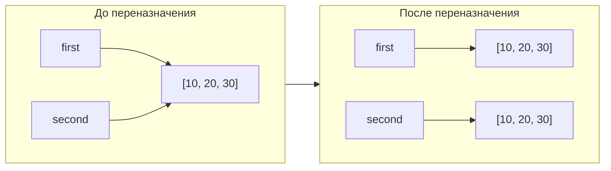
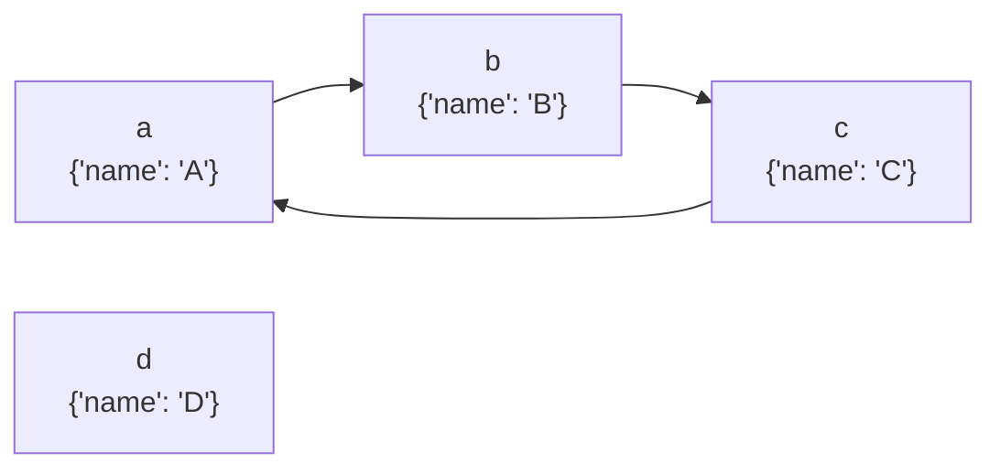

Министерство науки и высшего образования Российской Федерации
ФЕДЕРАЛЬНОЕ ГОСУДАРСТВЕННОЕ АВТОНОМНОЕ ОБРАЗОВАТЕЛЬНОЕ УЧРЕЖДЕНИЕ ВЫСШЕГО ОБРАЗОВАНИЯ
«НАЦИОНАЛЬНЫЙ ИССЛЕДОВАТЕЛЬСКИЙ УНИВЕРСИТЕТ ИТМО»
(Университет ИТМО)

Факультет Прикладной информатики
Образовательная программа: ТОП ИТ ПРО
Направление подготовки(специальность): 11.03.02 Автоматизация разработки и управления информационными системами

ПРАКТИЧЕСКАЯ РАБОТА № 2
По дисциплине «Основы программирования»
Тема: Управление объектами и памятью в Python

Выполнила: Гейко Валерия Игоревна
Проверил: Летенков Илья Алексеевич
Дата: 12.11.2026

Санкт-Петербург 2026

## Цель работы

Исследовать связь между именами и объектами, понять различия между присваиванием, поверхностным и глубоким копированием, а также познакомиться с механизмами управления памятью в CPython.

## Ход работы

### Задание 1. Имена, ссылки и изменяемость

#### Эксперимент А. Неизменяемый объект

Ожидаемый результат совпал с фактическим. Python имеет ссылочную модель, поэтому имя переменной – это ссылка на объект в памяти. Тип int – неизменяемый, строка a += 1 интерпретируется, как a = a + 1. При b = a переменные ссылаются на один объект, а в строке a += 1 создается новый объект, на который начинает ссылаться a. Именно поэтому до операции id совпадали, а после id(a) изменился. Ссылка внутри переменной b не изменилась, поэтому b всё еще равно 10.

#### Эксперимент B. Изменяемый объект

В данном эксперименте прогноз также совпал с результатом. Списки – изменяемый тип данных. При инициализации second = first обе переменные ссылаются на один объект в памяти, из-за чего second.append(30), изменяя объект, влияет на обе переменные. Id на этом этапе совпадают. После переназначения second на идентичный список создается новый объект, который хоть и равен по значению первому, но имеет другой адрес в памяти. Переменные ссылаются на разные объекты и second.remove(20) не влияет на первый список.

#### Практическая задача

В то время, как config2 = config1 копирует лишь ссылку на объект, функция deepcopy() создает идентичный объект на основе данного, в том числе копии вложенных объектов. Поэтому во втором случае все объекты независимы. В первом случае как сам список, так и оба вложенных списка были общими.

#### Вопросы для анализа

1. Меняет ли присваивание second = first сам объект? Нет, оно лишь связывает имя с объектом, создает ссылку на него.
2. Почему операция над неизменяемым объектом приводит к связыванию имени с другим объектом? Потому что неизменяемые объекты нельзя модифицировать на месте. Операции по типу сложения чисел или строк создают новый объект и привязывают имя к нему.
3. Как определить, что два имени обозначают один объект? С помощью оператора is. Он проверяет, ведут ли переменные к одному и тому же адресу в памяти.

### Задание 2. Поверхностное и глубокое копирование

| Операция | Новый внешний объект | Новые вложенные объекты | Изменения независимы |
|---|---|---|---|
| Присваивание | нет | нет | нет |
| Поверхностная копия | да | нет | 50/50 |
| Глубокая копия | да | да | да |

В первом случае сначала был создан вложенный список [0, 0, 0], а потом ссылка на него была продублирована трижды. В итоге все 3 вложенных списка ссылались на один объект. Во втором случае цикл for создает независимый список на каждой своей итерации.

#### Вопросы для анализа

1. Чем поверхностная копия отличается от глубокой? Поверхностная копия создает экземпляр внешнего объекта, при этом вложенные остаются неизменными (ссылаются на то же самое место в памяти). В случае с глубоким копированием вложенные объекты тоже получают свои копии.
2. Почему глубокое копирование не следует применять автоматически ко всем объектам? Оно ненужно, если вложенные объекты неизменяемые. Требует большего времени и может сказаться на производительности.
3. В каких случаях достаточно поверхностной копии? Если внутри объекта лежат str, int, tuple и т.д. Когда нет вложенности.

### Задание 3. Подсчет ссылок и время жизни объекта

Функция sys.getrefcount() показывает на одну временную ссылку больше, так как в функции был передан аргумент data. Это еще одна ссылка, которая существует, пока sys.getrefcount() не закончит выполнение.

Инструкции, увеличивающие счетчик: присваивание, помещение в другой объект, передача в качестве аргумента функции.

Инструкции, уменьшающие счетчик: удаление привязки объекта к переменной через del, очистка родительского контейнера, конец вызова функции.

Почему del alias удаляет имя, а не командует напрямую удалить объект? Потому что на него могут ссылаться другие переменные, которым этот объект может быть нужен.

Слабая ссылка не продлевает время жизни объекта, так как она не увеличивает счетчик ссылок. Когда их количество падает до нуля, объект уничтожается, и слабая ссылка этому не препятствует.

Слабые ссылки могут быть удобны в случае кэширования объемных данных (изображений и т.п.). Кэш не должен препятствовать удалению объекта, когда он больше не нужен.

#### Практическая задача

После удаления сильных ссылок из реестра автоматически удаляется соответствующая слабая ссылка.

#### Вопросы для анализа

1. При каком условии подсчет ссылок позволяет освободить объект? Когда количество ссылок падает до нуля.
2. Всегда ли освобождение Python-объекта означает немедленный возврат памяти операционной системе? Нет, чаще всего она возвращается самому Python, чтобы минимизировать количество запросов к OC. Существует специальный механизм, который при освобождении целого блока памяти отдает ее OC.
3. Чем сильная ссылка отличается от слабой? Слабая ссылка не увеличивает счетчик ссылок и соответственно не влияет на время жизни объекта, в отличие от сильной.

### Задание 4. Циклические ссылки и сборщик мусора

Для удаления созданного цикла недостаточно подсчета ссылок, так как элементы ссылаются сами на себя и счетчик никогда не упадет до нуля.

Назначение поколений сборщика мусора. Чтобы не тратить время на проверку всех объектов, Python делит их на поколения по времени жизни. Существует 3 поколения. 0: самые молодые объекты, которые часто меняются и освобождаются. 1: пережили одну проверку. 2: пережили много проверок. Молодые объекты проверятся намного чаще.

#### Практическая задача

Словари a, b,c ссылаются друг на друга, d независим. После del a, b, c внешние имена циклических узлов удаляются, но ссылки внутри dep сохраняются. Запуск gc.collect() удаляет цикл. узел d остаётся, так как на него сохраняется сильная ссылка.

#### Вопросы для анализа

1. Как возникает циклическая ссылка? Когда объекты ссылаются друг на друга, что получается замкнутая цепь.
2. Почему объект с ненулевым счетчиком ссылок иногда может быть недостижимой из программы? Это возможно, если внешняя ссылка на объект была удалена, но при этом внутри был цикл и объекты ссылались сами на себя.
3. Зачем сборщик мусора разделяет отслеживаемые объекты по поколениям? Каждый раз проверять все объекты – затратно по ресурсам и долго. Поэтому они делятся на 3 поколения по времени жизни. Старые объекты проверяются редко, когда новые – часто.

### Задание 5. Исследование потребления памяти

#### Часть 1

Размер контейнера не обязательно включает полный размер всех объектов. Контейнер хранит в себе заголовок, дополнительную информацию и ссылки на элементы. При этом сами элементы лежат в памяти отдельно.

#### Часть 2

Увеличивается ли размер списка после каждого append(). Нет. Python резервирует запасную память, чтобы каждый раз не обращаться к OC.

Почему список резервирует место с запасом? Потому что выделять память каждый раз – дорого. Каждый append требовал бы нового выделения памяти и копирования всех элементов в новое место.

Чем длина списка отличается от объема выделенной памяти? Длина – количество элементов в списке. Объем выделенной памяти – размер объекта в Кб, Мб и т.д.

#### Часть 3. Измерение через tracemalloc

В материализованной последовательности каждый объект реально хранится в памяти, когда объект, который хранит правило получения значений, содержит в себе только правило (start, stop и step в случае с range), по которому вычисляются значения. Соответственно, такой вариант занимает в разы меньше места.

### Итоговый анализ. Способы уменьшить лишнее потребление памяти

1. Вместо материальных последовательностей использовать объекты, которые хранят правило вычисления объектов. list(range(100000)) весит в разы больше, чем range(100000)
2. Не использовать глубокое копирование повсеместно, без необходимости. Deepcopy создает объект с таким же весом, когда обычное присваивание не требует создания нового объекта и выделения памяти соответственно.
3. Удалять ненужные ссылки. Тогда механизм подсчета ссылок сможет освободить память, если на объект не будет ссылок.
4. Использовать слабые ссылки по возможности. К примеру, для кэширования больших объектов.
5. Разрывать циклы и вручную освобождать память. Чтобы зацикленные объекты удалились, запускать gc.collect(). Но редко, ведь операция дорогая.

### Практическая задача

## Вывод

Наиболее опасные ошибки при работе с изменяемыми объектами – мутирование данных. Важно понимать, в каком случае можно использовать присваивание, а в каком следует выбрать поверхностное или глубокое копирование. Нужно следить за появлением циклов в программе. Так же не стоит отключать gc, ведь в таком случае может произойти утечка памяти.