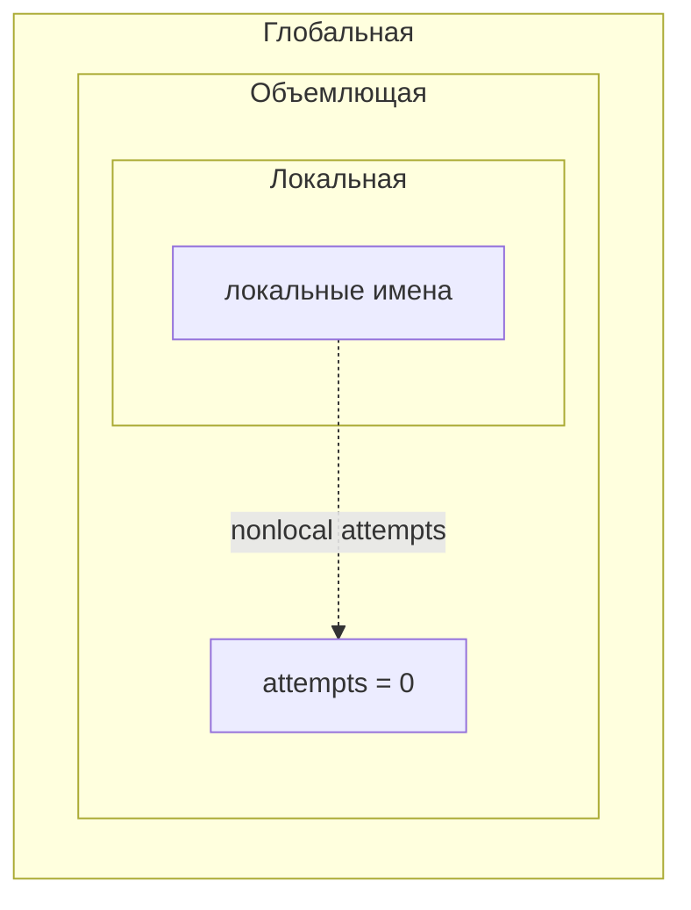

# Министерство науки и высшего образования Российской Федерации

**ФЕДЕРАЛЬНОЕ ГОСУДАРСТВЕННОЕ АВТОНОМНОЕ ОБРАЗОВАТЕЛЬНОЕ УЧРЕЖДЕНИЕ ВЫСШЕГО ОБРАЗОВАНИЯ**

**«НАЦИОНАЛЬНЫЙ ИССЛЕДОВАТЕЛЬСКИЙ УНИВЕРСИТЕТ ИТМО»**

**(Университет ИТМО)**

Факультет Прикладной информатики

Образовательная программа: ТОП ИТ ПРО

Направление подготовки (специальность): 11.03.02 Автоматизация разработки и управления информационными системами

# ПРАКТИЧЕСКАЯ РАБОТА № 3

По дисциплине «Основы программирования»

Тема: **Алгоритмы, коллекции и функции**

Выполнила: Гейко Валерия Игоревна  
Проверил: Летенков Илья Алексеевич  
Дата: 26.11.2026

Санкт-Петербург  
2026

---

## Цель работы

Научиться переводить условие задачи в алгоритм, выбирать подходящую структуру данных и разделять программу на небольшие функции с понятными контрактами.

---

## Ход работы

### Задание 1. Условия и классификация данных
[task_1.py](task_1.py)

Таблица сценариев с ожидаемыми и фактическими результатами:

| № | Результат | Тип работы | Пропуски | Ожидаемый результат | Фактический результат |
|---|-----------|------------|----------|---------------------|-----------------------|
| 1 | 0 | exam | 4 | Недостаточный, экзаменационная работа | Недостаточный, экзаменационная работа |
| 2 | 59 | project | 1 | Недостаточный, проектная работа | Недостаточный, проектная работа |
| 3 | -20 | practice | 0 | Ошибка: Некорректное количество баллов: -20 | Ошибка: Некорректное количество баллов: -20 |
| 4 | 80 | project | 3 | Хороший, проектная работа | Хороший, проектная работа |
| 5 | 75 | practice | 4 | Удовлетворительный, практическая работа | Удовлетворительный, практическая работа |
| 6 | 89 | exam | 1 | Хороший, экзаменационная работа | Хороший, экзаменационная работа |
| 7 | 90 | practice | 2 | Отличный, практическая работа | Отличный, практическая работа |
| 8 | 100 | exam | 5 | Хороший, экзаменационная работа | Хороший, экзаменационная работа |
| 9 | 74 | exam | 0 | Удовлетворительный, экзаменационная работа | Удовлетворительный, экзаменационная работа |
| 10 | 60 | something | 3 | Удовлетворительный, неизвестный | Удовлетворительный, неизвестный |
| 11 | 74 | exam | -3 | Ошибка: Некорректное количество пропусков: -3 | Ошибка: Некорректное количество пропусков: -3 |
| 12 | 89 | exam | -4 | Ошибка: Некорректное количество пропусков: -4 | Ошибка: Некорректное количество пропусков: -4 |

Ожидаемые результаты совпали с фактическими.

В начале функции `get_mark()` происходит проверка корректности данных. Если результат и количество пропусков не входят в допустимые диапазоны, то выполняется `return` и дальнейший код функции не выполняется.

Проверка результата идёт от верхней границы к нижней (если бы мы начали с условия `>= 60`, то в него попали бы практически все случаи, классификация была бы неверная и нижние ветви были бы недостижимы). Если первое условие выполнилось, то остальные не проверяются. Только после этого происходит учёт пропусков, ведь мы не можем уменьшать уровень, если он уже является недостаточным. `match / case` также работает до первого срабатывания.

При данном порядке все ветви достижимы.

---

### Задание 2. Циклы и базовые алгоритмические схемы
[task_2.py](task_2.py)

Сумма, минимум, максимум, чётные: **O(n)**, память **O(1)**.  
Подсчёт выше среднего — второй проход: **O(n)**, память **O(1)**.

**Линейный поиск:**  
Сложность: **O(n)** в среднем и худшем случаях, **O(1)** в лучшем.  
Количество операций зависит от длины массива и порядка элементов.  
Доп. памяти: **O(1)**.

**Проверка простоты:**  
Сложность: **O(√n)**.  
Количество операций зависит от величины числа.  
Доп. памяти: **O(1)**.  
Ограничение делителей квадратным корнем корректно: если `n = a·b` — составное и `a ≤ b`, то `a ≤ √n`. Иначе `a > √n` и `b ≥ a > √n`, тогда `a·b > n` — противоречие.

**Бинарный поиск:**  
Сложность: **O(log n)**, но работает уже на отсортированном массиве.  
Количество операций зависит от длины массива.  
Доп. памяти: **O(1)**.

**Сортировка выбором:**  
Сложность: **O(n²)**.  
Количество операций зависит от длины массива.  
Доп. памяти: **O(1)**.

Ниже приведена сравнительная таблица работы линейного и бинарного поиска на одинаковых списках:

| Количество элементов | Число сравнений (линейный поиск) | Число сравнений (бинарный поиск) |
|----------------------|----------------------------------|----------------------------------|
| 10 | 7 | 4 |
| 100 | 74 | 7 |
| 1000 | 760 | 8 |

На отсортированном массиве бинарный поиск заметно выигрывает по числу операций, так как количество кандидатов на каждой итерации уменьшается в 2 раза.

---

### Задание 3. Коллекции и выбор структуры данных
[task_3.py](task_3.py)

Множество подходит для хранения уникальных значений, так как в нём нет дубликатов и поиск по нему быстрее, чем по списку.

Кортеж можно использовать как ключ словаря, так как он неизменяемый тип данных.

Список нельзя использовать как ключ словаря, так как он изменяемый тип данных.

Словарь предпочтительнее списка для частого поиска результата по составному ключу, так как он хэшируемый и поиск в нём быстрее.

Ниже приведена оценка средней сложности добавления и поиска для использованных коллекций:

| Коллекция | Добавление | Поиск |
|-----------|------------|-------|
| Множество | O(1) в среднем | O(1) в среднем |
| Кортеж | — | O(1) |
| Список | O(1) амортизированно (`append`), O(n) вставка | O(n), O(1) по индексу |
| Словарь | O(1) в среднем | O(1) в среднем |

Для множеств и словарей O(1) в среднем случае, при равномерном хэшировании. В худшем случае — O(n).

---

### Задание 4. Функции, параметры и области видимости
[task_4.py](task_4.py)

**Схема областей видимости (LEGB):**

**Вложенность:** G ⊃ E ⊃ L — области вложены по правилам вложенности функций: `inner` определена внутри `outer`, `outer` — на уровне модуля. **B (builtins)** не вложена в G: она доступна из любой области, но проверяется **последней** в цепочке L → E → G → B.

Python ищет имя по цепочке: локальная область видимости, объемлющая, глобальная, встроенные имена (`print`, `len` и т.д.). Останавливается на первом вхождении. По умолчанию присваивание создаёт локальную переменную. Чтобы присвоить имя в глобальной / объемлющей области, нужно использовать `global` / `nonlocal` соответственно.

**Ошибка изменяемого значения по умолчанию:**

Значение по умолчанию вычисляется при первой инициализации функции, а не при её вызове. Все вызовы без явного указания `results` используют один и тот же список. Он живёт до тех пор, пока существует функция.

---

### Задание 5. Анализатор учебных результатов
[task_5.py](task_5.py)

**Декомпозиция:**

Программа разделена на функции, каждая из которых выполняет определённую задачу. Элементарные агрегаты выполняют действия над одним списком / числом, а вывод и сбор полной информации о студенте вынесены в отдельные процедуры. Такой подход позволяет легко тестировать каждую часть отдельно и менять формат вывода.

**Сложность:**

Временная сложность построения общей статистики: **O(N · K)**, где N — количество студентов, K — среднее количество оценок у студента. Мы проходим по каждому результату ровно один раз при вычислении `mean/min/max`.

Пространственная сложность: **O(N · K)** для хранения копий списков результатов в `student_summary`, плюс **O(N)** для хранения сводок и словаря категорий.

Исходный словарь не изменяется, что гарантирует безопасность данных.

---

## Вывод

Благодаря декомпозиции кода листинг стал более читабельным: каждая функция выполняет определённую задачу. Не нужно помнить код всей программы, чтобы разобраться в работе какого-то конкретного функционала. Также это облегчает тестирование, ведь каждую функцию можно проверить отдельно.